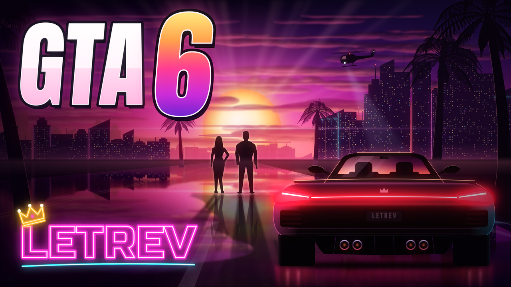

# LETREV — GTA 6 YouTube thumbnail



- `gta6-letrev-thumbnail.png` / `.jpg`: final 1280x720 (16:9) thumbnail, under YouTube's 2 MB limit.
- Everything is drawn in code (`scene.js`): sky, sun, city, palms, helicopter, wet street reflections, the car, the two silhouettes and the typography. No external images are used.

## Regenerate

```bash
npm install            # fonts (Anton, Russo One, ...) from @fontsource
npm run render         # renders out/final.png at 2x, then writes the 1280x720 PNG/JPG
node render.js specimen  # optional: compare neon font options for LETREV
```

Requires Node with Playwright/Chromium and Python 3 with Pillow.
